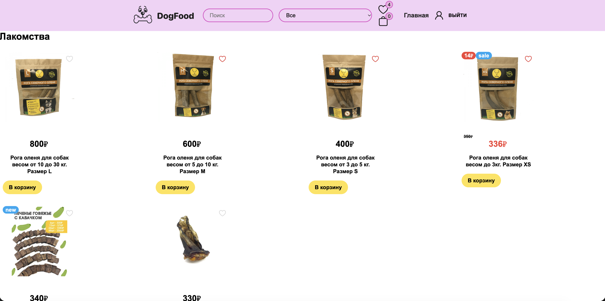
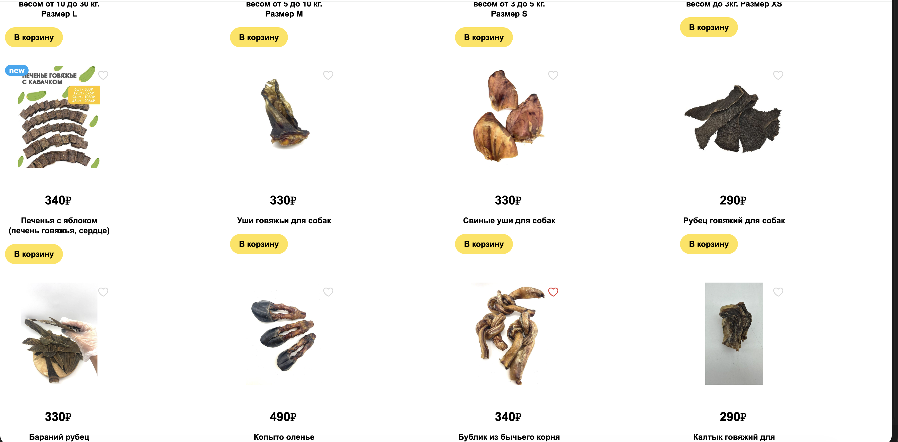
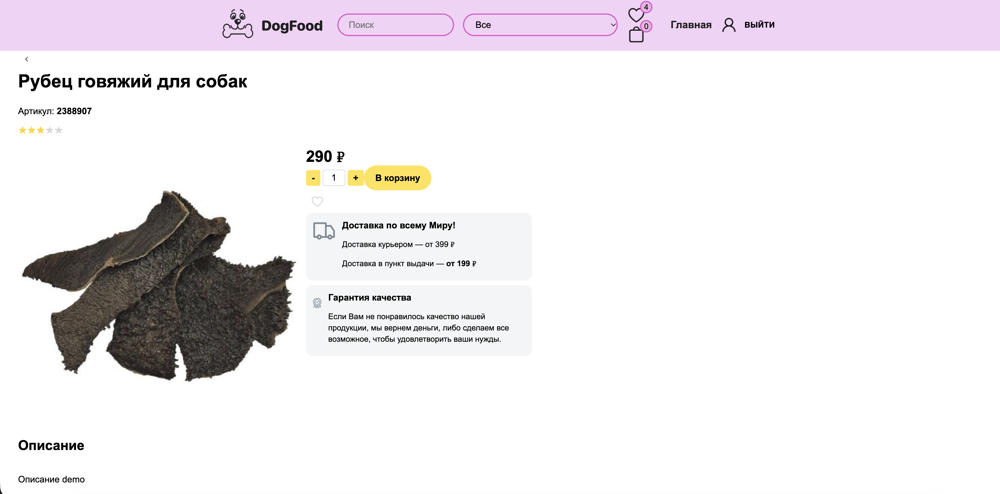
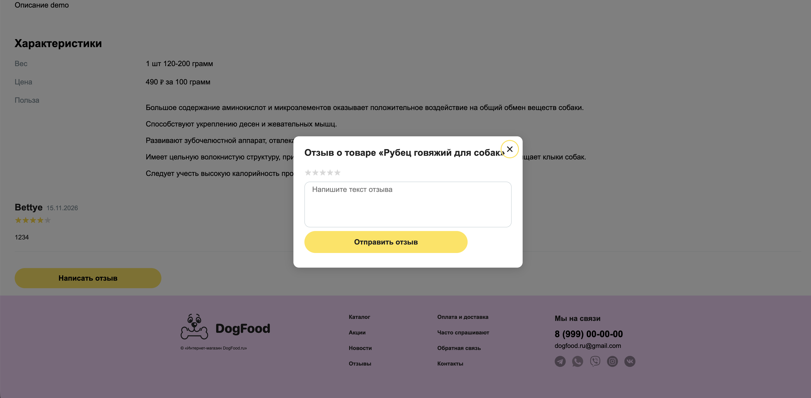
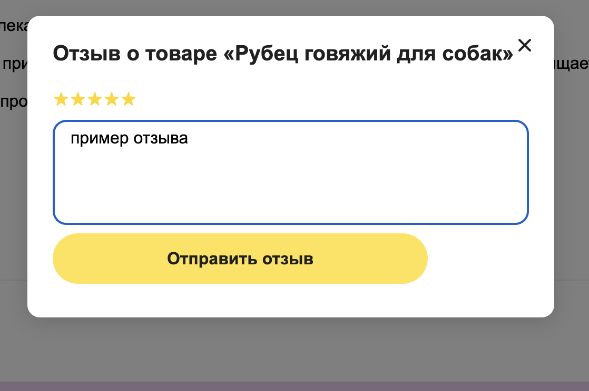
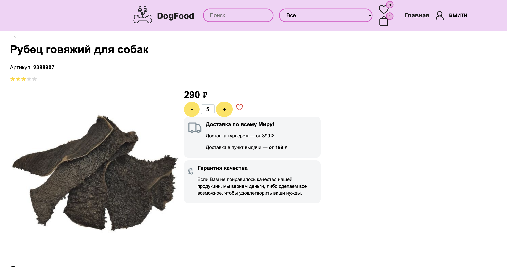
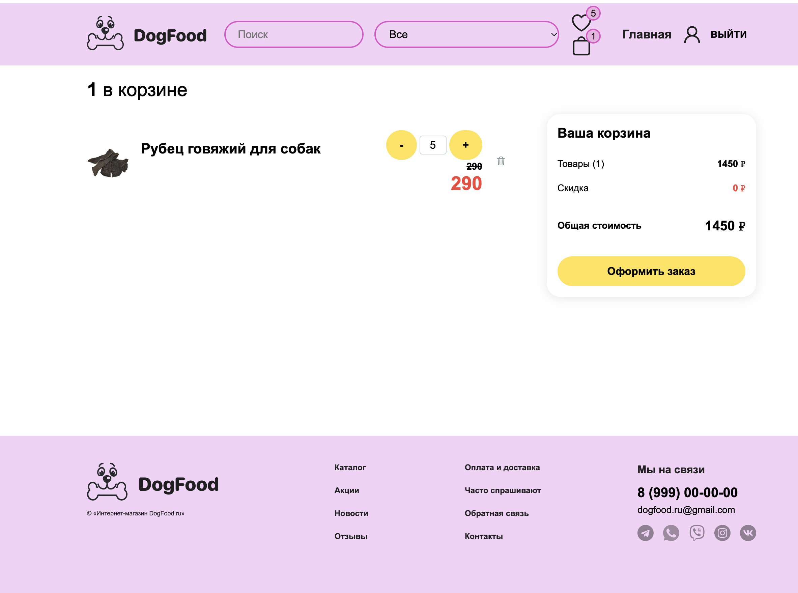
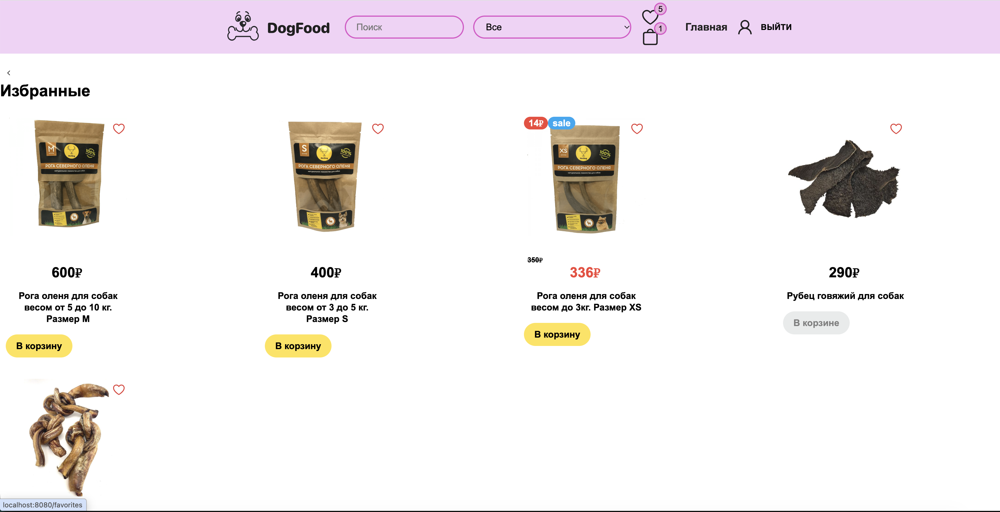
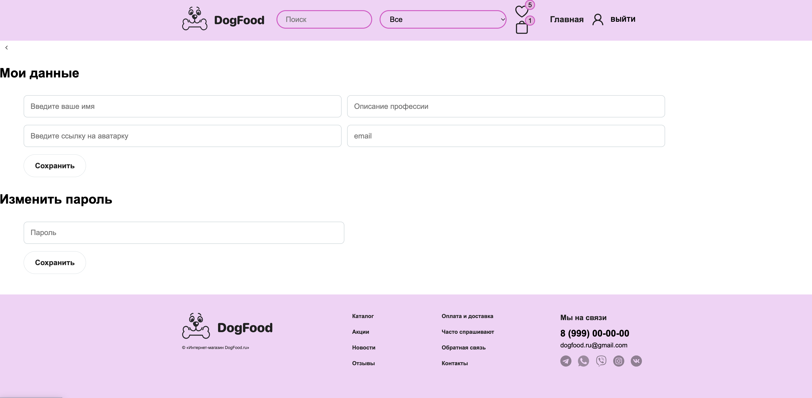

# React PRO — финальный проект

## Цель проекта

Доработать исходный проект, применив знания и подходы, изученные в рамках курса.

Основная задача — не переписать приложение с нуля, а улучшить существующий проект:

- привести код к более понятной архитектуре;
- оптимизировать рендеры;
- добавить современные возможности React;
- реализовать модальные окна через Portal;
- применить `useRef` в реальных сценариях;
- добавить альтернативную сборку через esbuild или SWC;
- использовать возможности React 19.

---

## Стек технологий

| Категория | Технология | Версия |
|---|---|---|
| Фреймворк | React | 19.3.x |
| State Management | Redux Toolkit + RTK Query | 2.2.x |
| Роутинг | React Router DOM | 6.25.x |
| UI-библиотеки | MUI, @emotion/react & styled | 5.16.x |
| Формы | React Hook Form + yup | 7.52.x / 1.4.x |
| Уведомления | react-toastify | 10.x |
| Стили | CSS Modules, PostCSS, Autoprefixer, cssnano | — |
| Линтеры | ESLint, Prettier, Stylelint | 8.42.x / 2.8.x / 15.7.x |
| Сборщики | Webpack 5, Vite 5 (esbuild), esbuild | — |
| Язык | TypeScript | 5.x |

---

## Что уже реализовано в стартовом проекте

В исходном проекте уже есть:

- **Redux Toolkit** и **RTK Query**;
- **React Router v6**;
- защищённые страницы;
- **React Hook Form** и **yup** на страницах регистрации и авторизации;
- поиск с query-параметрами и debounce;
- infinite scroll;
- корзина;
- контекст пользователя;
- настроенная сборка через **Webpack**;
- конфигурации:
  - ESLint;
  - Prettier;
  - Stylelint;
  - TypeScript.

В стартовом проекте пока отсутствовали:

- `React.Portal`;
- практические сценарии использования `useRef`;
- оптимизация рендеров;
- альтернативная сборка через esbuild/SWC;
- React 19 hooks;
- полная архитектурная реорганизация проекта.

---

# Задачи проекта

## 1. Архитектура и структура проекта

Необходимо привести проект к более понятной и масштабируемой структуре.

### Что нужно сделать

Вынесите переиспользуемые UI-компоненты в:

```text
src/shared/ui
```

Например:

```text
src/shared/ui/Button
src/shared/ui/Input
src/shared/ui/Loader
src/shared/ui/Modal
```

Разделите бизнес-функциональность по фичам.

Например:

```text
src/features/cart
src/features/auth
src/features/search
src/features/products
```

Страницы приложения должны находиться в:

```text
src/pages
```

По возможности уберите лишний проброс props через несколько уровней компонентов. Если данные уже находятся в Redux или RTK Query, используйте соответствующие селекторы и хуки.

### Рекомендуемая структура

```text
src/
├── shared/
│   └── ui/
├── features/
│   ├── auth/
│   ├── cart/
│   ├── products/
│   └── search/
├── pages/
└── ...
```

### Чек-лист

- [x] В `shared/ui` находятся только презентационные UI-компоненты.
- [x] UI-компоненты не содержат бизнес-логику.
- [x] UI-компоненты не работают напрямую с API.
- [x] UI-компоненты не обращаются напрямую к Redux Store.
- [x] Данные и обработчики передаются в UI-компоненты через `props`.
- [x] Фичи изолированы в отдельных папках.
- [x] Нет необоснованных глубоких цепочек передачи props.

---

## 2. Оптимизация рендеров

Необходимо найти реальные проблемы с лишними рендерами и выполнить оптимизацию.

### Что нужно сделать

Используйте **React DevTools Profiler** и найдите хотя бы один компонент или участок приложения, который рендерится чаще, чем необходимо.

После этого примените подходящую оптимизацию:

- `React.memo`;
- `useMemo`;
- `useCallback`.

Особое внимание можно уделить спискам товаров, корзине и компонентам, которые получают большое количество props.

Примерные места:

```text
src/features/products
src/features/cart
```

> Не нужно добавлять `useMemo`, `useCallback` и `React.memo` во все компоненты подряд. Оптимизация должна применяться там, где она действительно имеет смысл.

### Чек-лист

- [x] Использован React DevTools Profiler.
- [x] Найден хотя бы один hotspot.
- [x] `React.memo` используется там, где это действительно уменьшает количество рендеров.
- [x] `useMemo` применяется для вычислений, которые нет смысла выполнять при каждом рендере.
- [x] `useCallback` используется для стабилизации функций там, где это необходимо.
- [x] В README описано, что именно было оптимизировано.

---

## 3. React Portal для модальных окон

Реализуйте универсальное модальное окно через **React Portal**.

### Что нужно сделать

Добавьте в `public/index.html` отдельный контейнер для модальных окон:

```html
<div id="modal-root"></div>
```

Создайте компонент:

```text
src/shared/ui/Modal
```

Модальное окно должно рендериться через:

```js
ReactDOM.createPortal(...)
```

### Требования к поведению

Модальное окно должно:

- открываться и закрываться корректно;
- закрываться по нажатию `Escape`;
- корректно обрабатывать клик по overlay;
- управлять фокусом.

При открытии:

- фокус должен переходить на элемент внутри модального окна.

При закрытии:

- фокус должен возвращаться на элемент, который открыл модальное окно.

### Чек-лист

- [x] Используется `ReactDOM.createPortal`.
- [x] Модальное окно рендерится внутри `#modal-root`.
- [x] Работает закрытие по `Escape`.
- [x] Корректно обработан клик по overlay.
- [x] При открытии фокус переходит внутрь модального окна.
- [x] После закрытия фокус возвращается на элемент-триггер.

---

## 4. Практическое применение useRef

Используйте `useRef` минимум в двух разных сценариях.

### Сценарий 1 — работа без перерендера

Используйте `useRef` для хранения значения между рендерами без вызова нового рендера.

Например:

- счётчик кликов;
- идентификатор таймера;
- предыдущее значение;
- техническое состояние компонента.

### Сценарий 2 — работа с DOM

Используйте `ref` для взаимодействия с DOM.

Например:

- autofocus на поле логина;
- autofocus на поле регистрации;
- управление фокусом в модальном окне.

Примерное место:

```text
src/features/auth/LoginForm.jsx
```

или:

```text
src/shared/ui/Modal
```

### Чек-лист

- [x] Есть пример хранения значения через `useRef` без перерендера.
- [x] Есть пример взаимодействия с DOM через `ref`.
- [x] Использование `useRef` имеет практический смысл.

---

## 5. Альтернативная сборка: esbuild или SWC

Помимо существующей Webpack-сборки необходимо реализовать альтернативный вариант сборки проекта.

Можно выбрать один из вариантов:

- **esbuild**;
- **SWC**;
- **Vite + SWC**.

Например:

```text
esbuild.config.js
```

или:

```text
vite.config.js
```

### Что нужно сделать

1. Настроить альтернативную сборку.
2. Убедиться, что проект успешно собирается.
3. Замерить время сборки.
4. Сравнить размер итогового bundle.
5. Записать результаты в README.

### Пример таблицы

| Сборщик | Build time | Размер build |
|---|---:|---:|
| Webpack | 4.2 сек | 1.8 MB |
| esbuild | 0.7 сек | 1.6 MB |

> Значения в таблице приведены только как пример. Используйте результаты своей сборки.

### Чек-лист

- [x] Альтернативная сборка запускается.
- [x] Production build создаётся без ошибок.
- [x] Замерено время сборки Webpack.
- [x] Замерено время альтернативной сборки.
- [x] Сравнён размер итоговых файлов.
- [x] Результаты добавлены в README.

---

## 6. React 19 Hooks

Используйте минимум один из современных хуков React 19:

- `useActionState`;
- `useOptimistic`.

### Вариант 1 — useActionState

Можно реализовать форму добавления комментария.

Примерное место:

```text
src/features/productDetails/AddCommentForm.jsx
```

Используйте `useActionState` для обработки отправки формы.

После успешной отправки форма должна очищаться.

### Вариант 2 — useOptimistic

Можно реализовать оптимистичное обновление интерфейса.

Например:

- добавление товара в избранное;
- изменение состояния товара;
- добавление комментария;
- изменение количества товара в корзине.

UI должен обновляться сразу, не дожидаясь ответа сервера.

Если запрос завершился ошибкой, состояние интерфейса должно корректно восстановиться.

### Чек-лист

- [x] Использован `useActionState` И `useOptimistic`.
- [x] Реализация находится в реальной части приложения, а не в отдельном тестовом компоненте.
- [x] Пользователь видит изменение состояния интерфейса.
- [x] Для `useOptimistic` UI реагирует до ответа сервера.

---

# README проекта

В вашем итоговом `README.md` обязательно добавьте следующие разделы.

## Что было сделано

### 1. Архитектура — Feature-Sliced Design (FSD)

Проект перестроен по методологии FSD. Уровни зависимостей пронумерованы в названиях папок, чтобы зависимости шли только в одном направлении — снизу вверх.

Всего 144 файла организованы в шесть директорий:

- `shared/ui` — простые компоненты без бизнес-логики: Button, Input, Loader, Logo, Modal, Price, Rating;
- `features/*` — изолированные бизнес-фичи: корзина, авторизация, поиск, лайки;
- `widgets/*` — композиционные блоки, собранные из features и entities: Header, Footer, CardList, LoadMore, ReviewList;
- `entities/Card` — модель карточки товара;
- `pages/*` — полноценные страницы из widgets: HomePage, ProductPage, CartPage, FavoritesPage, ProfilePage, SignInPage, SignUpPage, NotFoundPage;
- `app` — корневая конфигурация, провайдеры, роутинг.

Импорты идут строго снизу вверх: shared → entities → features → widgets → pages → app.

### 2. Оптимизация рендеров

Через React DevTools Profiler выяснил, что при обновлении списка товаров — во время debounce поиска или смены страницы — ререндерились все карточки. Причина: `data?.products` из RTK Query каждый раз возвращал новую ссылку на массив, из-за чего `React.memo` на `Card` не срабатывал.

Решение: добавил `useMemo` для стабильной ссылки на массив продуктов и для `filteredProducts`, стабилизировал callback'и через `useCallback`. Теперь карточки ререндерятся только при реальном изменении данных.

### 3. React Portal — Модальное окно

Компонент `src/shared/ui/Modal` рендерится через `ReactDOM.createPortal(...)` в контейнер `#modal-root`. При закрытии работает `Escape`, клик по overlay, а также перенос фокуса внутрь модалки при открытии и возврат на кнопку-триггер при закрытии.

### 4. useRef

**Без перерендера.** В `src/1-app/ui/App.tsx` useRef хранит флаг `hasSynced` — нужно было отслеживать состояние между рендерами без лишнего обновления UI.

**Работа с DOM.** useRef использован в шести местах:
- Modal — ref на кнопку закрытия и на контейнер модалки;
- ReviewList — ref на кнопку открытия формы;
- ReviewForm — ref на форму;
- LoadMore — ref на контейнер для Intersection Observer;
- Auth Form — ref на поле email для autofocus.

### 5. Альтернативная сборка через esbuild

Настроен `esbuild.config.js` с кастомными плагинами для SVG и CSS Modules. CSS проходит PostCSS + Autoprefixer + cssnano. В production-режиме esbuild собирает проект за ~3 секунды против ~23 секунд у Webpack.

Vite (`npm run build:vite`) изначально не собирал бандлы — был конфликт в конфигурации `assetFileNames`. Проблема решена: функция заменена на строковый формат, и Vite теперь тоже работает (7.7 сек). Подробности — в `BUILD_COMPARISON.md`.

### 6. React 19 Hooks

- `useOptimistic` — в `likeButton`: лайк отображается мгновенно, без ожидания ответа сервера. Если запрос падает, состояние откатывается назад.
- `useActionState` — в формах авторизации: управление состоянием отправки формы с визуальной индикацией прогресса.

### 7. Линтеры

ESLint проверяет TypeScript-код, Prettier форматирует все файлы, Stylelint следит за CSS. Husky + lint-staged запускают линтеры при коммите. conventional-changelog стандартизирует commit-сообщения.

---

## Структура проекта

Проект организован по принципу **Feature-Sliced Design** (FSD):

```text
src/
├── 1-app/                  # Корневая конфигурация приложения
│   └── ui/                 # Корневой компонент App, провайдеры
├── 2-pages/                # Страницы приложения (view-уровень)
│   ├── FavoritesPage/ui    # Избранные товары
│   ├── HomePage/ui         # Главная страница
│   ├── NotFoundPage/ui     # 404
│   ├── ProductPage/ui      # Страница товара
│   ├── ProfilePage/ui      # Профиль пользователя
│   ├── SignInPage/ui       # Авторизация
│   └── SignUpPage/ui       # Регистрация
├── 3-widgets/              # Композиционные блоки (собираются из features + entities)
│   ├── CardList/ui         # Список карточек товаров
│   ├── Footer/ui           # Подвал сайта
│   ├── Header/ui           # Шапка сайта
│   ├── LoadMore/ui         # Бесконечный скролл / подгрузка
│   └── ReviewList/         # Форма и список отзывов
├── 4-features/             # Бизнес-фичи (добавляют поведение)
│   ├── auth/               # Авторизация
│   │   ├── model/          # AuthProvider (контекст авторизации)
│   │   ├── shared/Form/    # Переиспользуемая форма с Yup
│   │   ├── SignInForm/     # Форма входа
│   │   └── SignUpForm/     # Форма регистрации
│   ├── cart/               # Корзина
│   │   ├── CartPage/ui     # Страница корзины, CartItem, CartList
│   │   └── ui/CartCounter/ # Счётчик количества в корзине
│   ├── likeButton/         # Лайки (useOptimistic)
│   └── search/             # Поиск и сортировка
│       └── ui/Search       # Поле поиска с debounce
│       └── ui/Sort         # Сортировка товаров
├── 5-entities/             # Сущности (модели данных)
│   └── Card/ui             # Карточка товара — модель продукта
├── 6-shared/               # Общий код (переиспользуется везде)
│   ├── api/                # HTTP-клиент, кастомные хуки
│   ├── assets/             # Иконки, изображения
│   ├── hooks/              # Переиспользуемые хуки
│   ├── providers/          # RouterProvider, роут-конфиг
│   ├── store/              # Redux slices, reducers, HOCs
│   ├── types/              # Общие TypeScript-типы
│   ├── ui/                 # Презентационные компоненты
│   │   ├── Button/ui       # Кнопка
│   │   ├── Input/ui        # Инпут
│   │   ├── Loader/ui       # Лоадер
│   │   ├── Logo/ui         # Логотип
│   │   ├── Modal/ui        # Модальное окно через Portal
│   │   ├── Price/ui        # Форматирование цены
│   │   └── Rating/ui       # Рейтинг звёздами
│   └── utils/              # Утилиты
└── index.tsx               # Точка входа
```

### Описание уровней

| Уровень | Назначение | Пример |
|---|---|---|
| `app` | Точка входа, глобальные провайдеры | `<App />`, `index.tsx` |
| `pages` | Полноценные страницы | `HomePage`, `CartPage` |
| `widgets` | Блоки из features и entities | `Header`, `CardList`, `ReviewList` |
| `features` | Самостоятельная функциональность | Лайки, корзина, поиск |
| `entities` | Модели данных | Карточка товара |
| `shared` | Общий код без логики | Button, Modal, хуки, типы |

### Импорты по уровням

```typescript
import { Header }        from '@widgets/Header';
import { Search }        from '@features/search';
import { Card }          from '@entities/Card';
import { Button }        from '@shared/ui/Button';
```

Импорты идут только снизу вверх — нижние уровни не зависят от верхних.

### Количество файлов

| Метрика | Значение |
|---|---|
| Файлов в `src/` | 144 |
| Размер исходников (`du -sh src`) | ~600 КБ |

---

## Сравнение сборок

В проекте реализована альтернативная сборка через **esbuild** (кастомный `esbuild.config.js`) и **Vite** (Rollup + esbuild).

### Результаты замеров (production mode)

Замеры выполнены на macOS, 2026-11-16.

| Сборщик | Build time | Размер JS | Размер CSS | Полный размер dist | Статус |
|---|---:|---:|---:|---:|---|
| Webpack 5 | 23.5 сек | 697 КБ | 48 КБ | ~790 КБ | ⚠️ 3 предупреждения о размере бандла |
| Vite 5 | 7.7 сек | 692 КБ | 34 КБ | ~758 КБ | ✅ Работает |
| esbuild | 3.1 сек | 1218 КБ | 17 КБ | ~1.27 МБ | ✅ Работает |

### Детали Webpack сборки

```
dist/
├── static/
│   ├── scripts/main.[hash].js     697 КБ
│   ├── styles/main.[hash].css      48 КБ
│   └── images/*.svg                 9 файлов (~27 КБ)
└── index.html
Итого: ~790 КБ
```

Webpack выдаёт предупреждения: JS-файл превышает лимит 244 КБ, рекомендуется code-splitting через `import()`.

### Детали esbuild сборки (production)

```
dist-esbuild/
├── static/
│   ├── scripts/main.[hash].js       ~1.2 МБ
│   ├── styles/main.[hash].css        17 КБ
│   └── images/logo.svg                7 КБ
└── index.html                         0.5 КБ
Итого: ~1.27 МБ
```

esbuild использует кастомные плагины для SVG и CSS Modules. Все стили подставляются в бандл через `<style>` тег. Бандл крупнее Webpack примерно в 1.6 раза — esbuild не делает агрессивный tree-shaking.

### Детали Vite сборки

Vite изначально не собирал бандлы — был конфликт в конфигурации `assetFileNames` (функция вместо строки) и пустой корневой `index.html`. Проблема решена:

1. `assetFileNames` заменён на строку `'static/[name].[hash][extname]'`;
2. Корневой `index.html` приведён в соответствие с правильным содержимым.

```
dist-vite/
├── static/
│   ├── scripts/index.[hash].js    692 КБ
│   ├── index.[hash].css            34 КБ
│   └── *.svg                        13 КБ
└── index.html                       0.48 КБ
Итого: ~758 КБ
```

### Почему esbuild быстрее Webpack

esbuild написан на Go и компилируется в нативный код, Webpack работает на чистом JavaScript. Минификация встроена в esbuild (в Webpack используется отдельный плагин Terser). Tree-shaking esbuild выполняется на уровне ES-модулей без парсинга AST.

### Запуск

```bash
# Webpack (основная сборка)
npm run build

# Vite (альтернативная сборка)
npm run build:vite

# Esbuild (альтернативная сборка)
npm run build:esbuild
```
---

# Формат сдачи

Для сдачи проекта необходимо предоставить:

1. Ссылку на **GitHub-репозиторий** с финальным кодом.
2. Заполненный `README.md`.
3. Демонстрацию ключевых изменений — скриншоты или GIF.

Необходимо продемонстрировать:

- модальное окно через React Portal;
- форму с `useActionState` или оптимистичный UI с `useOptimistic`;
- пример оптимизации рендеров.

---

# Итоговый чек-лист

- [x] проект запускается без ошибок (`npm start`);
- [x] production build создаётся (Webpack, Vite, esbuild);
- [x] структура проекта переработана по методологии FSD;
- [x] UI-компоненты вынесены в `shared/ui` (7 компонентов);
- [x] фичи разделены по папкам;
- [x] проведён анализ через React DevTools Profiler;
- [x] выполнена оптимизация рендеров;
- [x] реализован Modal через React Portal с управлением фокусом;
- [x] useRef применён: 1 раз для хранения значения + 5 раз для работы с DOM (см. раздел "Что было сделано");
- [x] настроена альтернативная сборка через esbuild и Vite;
- [x] использованы React 19 hooks (`useActionState` + `useOptimistic`).

### Оптимизация рендеров

При обновлении списка товаров (debounce поиска, смена страницы) все карточки ререндерились зря. Причина — новый массив от RTK Query ломал `React.memo`. Добавил `useMemo` для массива продуктов и `useCallback` для callback'ов в карточках.

### useRef

Один useRef хранит флаг синхронизации в `App.tsx` без перерендера. Пять refs работают с DOM: кнопки закрытия модалки, контейнер модалки, кнопка открытия формы, форма, Intersection Observer, поле email для autofocus.

### React 19 Hooks

`useOptimistic` в лайках — лайк появляется мгновенно, откатывается при ошибке. `useActionState` в формах авторизации — показывает прогресс отправки.

### Сборка

| Сборщик | Build time | Полный размер |
|---|---:|---:|
| Webpack 5 | 23.5 сек | ~790 КБ |
| Vite 5 | 7.7 сек | ~758 КБ |
| esbuild | 3.1 сек | ~1.27 МБ |

Подробности — в `BUILD_COMPARISON.md`.

## Итоговый статус

- [x] проект запускается без ошибок;
- [x] production build успешно создаётся;
- [x] структура проекта переработана;
- [x] UI-компоненты вынесены в `shared/ui`;
- [x] фичи разделены по папкам;
- [x] проведён анализ через React DevTools Profiler;
- [x] выполнена осмысленная оптимизация рендеров;
- [x] реализован Modal через React Portal;
- [x] реализовано управление фокусом в модальном окне;
- [x] `useRef` применён;
- [x] настроена альтернативная сборка;
- [x] выполнено сравнение сборок;
- [x] использованы React 19 hooks;
- [x] README заполнен.










